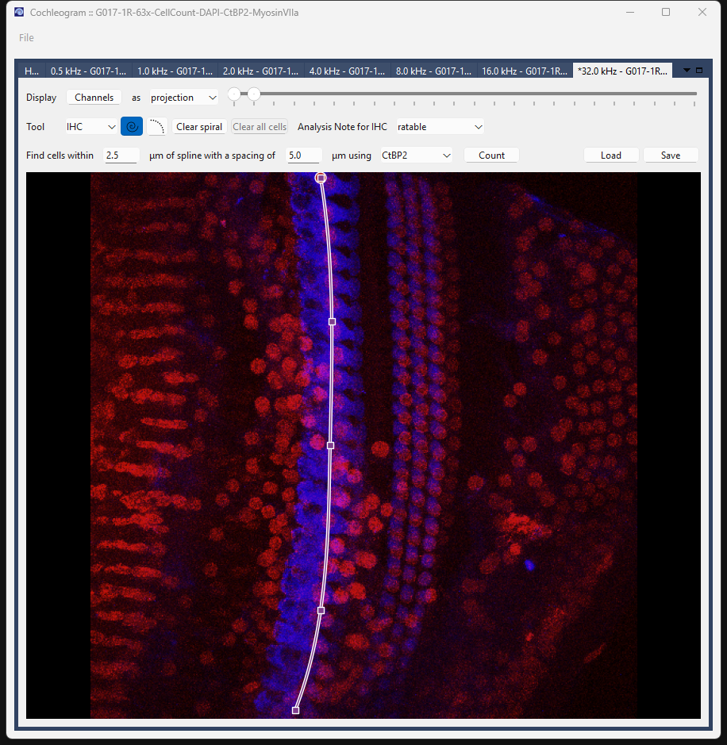
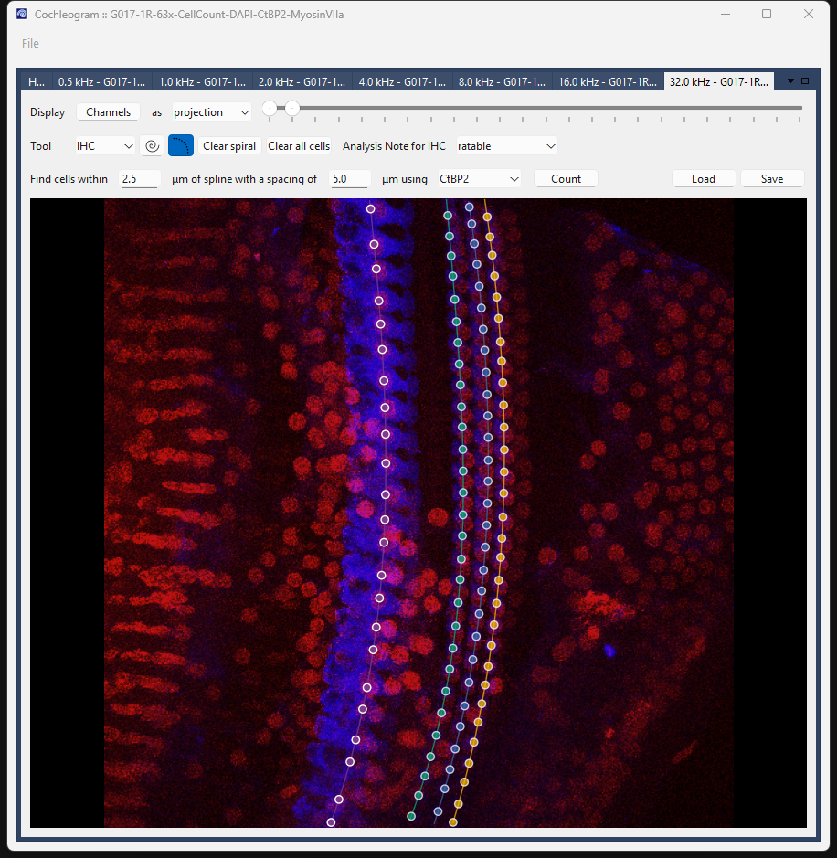

# Cell Counting Workflow

Use this workflow when you have imaged specific cochlear regions at high magnification (typically 63×) to count hair cells at defined frequencies.

**Goal:** count IHC and OHC cells per 100 µm at each imaged frequency location.

The spiral serves two purposes in this workflow: it guides the automated cell-detection algorithm, and it provides the total path length used to calculate cells per 100 µm.

---

## File naming

Name each tile with its target frequency using the `<n>p<d>_kHz` pattern:

```
G017-1R_8p0_kHz.lif     ← 8.0 kHz
G017-1R_16p0_kHz.lif    ← 16.0 kHz
G017-1R_32p0_kHz.lif    ← 32.0 kHz
```

Cochleogram reads the frequency from the filename and associates it with that tile.

---

## Step 1: Load the data

1. Open the **File** menu.
2. Choose **ROI scans**.
3. Navigate to your file or folder.

Each tile loads into its own tab, labeled by frequency.

---

## Step 2: Trace spirals through each row

Switch to **Spiral mode** by pressing `S`.

Unlike the frequency map workflow, you need a separate spiral for **every row of cells** — IHC and all three OHC rows. The spiral length for each row is used to normalize the cell count.

Work through each row in turn:

| Key | Row |
|-----|-----|
| `I` | Inner Hair Cells (IHC) |
| `1` | Outer Hair Cells row 1 (OHC1) |
| `2` | Outer Hair Cells row 2 (OHC2) |
| `3` | Outer Hair Cells row 3 (OHC3) |

For each row:

1. Select the row with the key above.
2. **Right-click** to place nodes along that row. You need at least 4 nodes.
3. The app fits a smooth B-spline through your nodes.


*IHC spiral traced at 32 kHz. Square markers = nodes you placed; the curve fits through them automatically.*

Repeat for OHC1, OHC2, and OHC3.

---

## Step 3: Detect cells

Switch to **Cell mode** by pressing `C`.

**Automatic detection:**

For each row:

1. Select the row (`I`, `1`, `2`, or `3`).
2. Set the search parameters in the toolbar:
   - **Find cells within** — how far from the spline to search (µm)
   - **with a spacing of** — minimum distance between detected cells (µm)
   - **using** — which channel to detect on (typically CtBP2 for IHC, MyosinVIIa for OHC)
3. Click **Count**.


*Cells detected across all rows. White circles = IHC; colored dots = OHC1–3.*

**Manual corrections:**

| Action | Result |
|--------|--------|
| Right-click | Add a cell |
| Shift+right-click | Remove a cell |

Run Count and correct for each row before moving on.

---

## Step 4: Mark extra (supernumerary) OHCs

Occasionally a fourth row of outer hair cells appears that does not fall cleanly along OHC1–3. These are supernumerary cells and should be counted separately.

Press `4` to select the **Extra** row, then right-click to mark each supernumerary cell individually. These cells are tracked independently and do not affect the OHC1–3 counts.

---

## Step 5: Save

Press **Ctrl+S** or go to **File → Save analysis**.

---

## Keyboard shortcuts

| Key | Action |
|-----|--------|
| `S` | Spiral mode |
| `C` | Cell mode |
| `I` | Select IHC row |
| `1` / `2` / `3` | Select OHC row 1 / 2 / 3 |
| `4` | Select Extra (supernumerary) row |
| `Ctrl+S` | Save analysis |
| `Esc` | Cancel in-progress action |

---

## Troubleshooting

**Count marks noise or misses cells.**
Adjust the search width and spacing before running. A tighter width (e.g., 2.5 µm) reduces false positives; a smaller spacing value catches closely-packed cells. Clean up the remainder manually.

**I have cells that fall between the standard OHC rows.**
Use the Extra row (`4`) for supernumerary OHCs. Do not force them onto OHC1–3.

**A row is unusable (e.g., missing tissue, poor histology).**
Select that row and mark it as **Unratable** in the toolbar. This excludes that specific row from counts. Each row has its own Unratable flag — marking IHC as unratable does not affect OHC counts, and vice versa.
